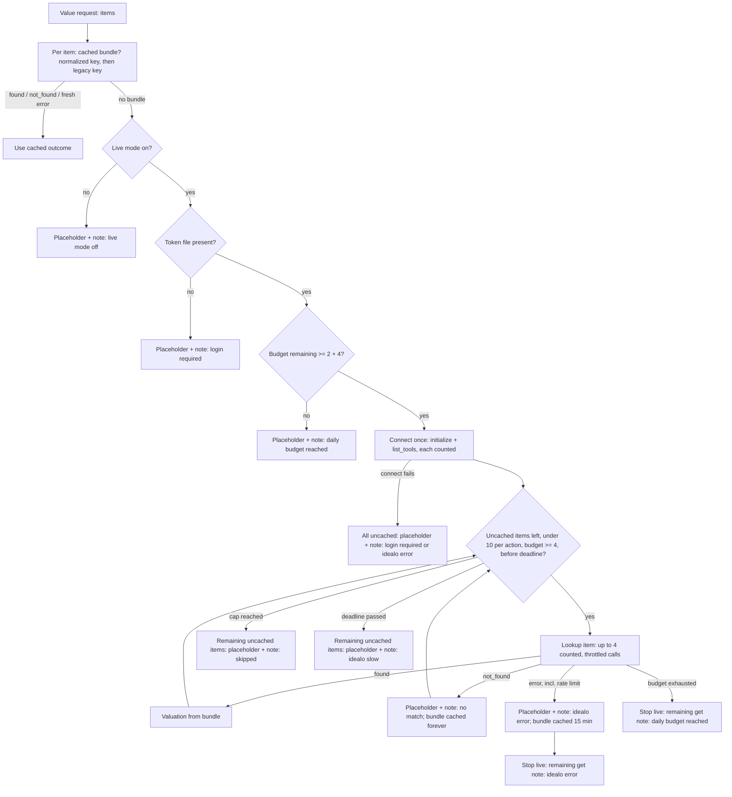

# idealo Call Budget and Demo Safety - Plan

---

## Goal Capsule

- **Objective:** During the 5-hour hackathon, the team can develop, test and demo CleanBreak all day without using up the shared idealo trial budget (500 calls/day, 3 calls/s), and the demo never hangs, crashes or shows a made-up price as idealo data.
- **Means:** One budget-guarded entry point for every idealo MCP request (KTD1). Live mode is off by default (KTD2). Lookups are cache-first, with a pre-flight cost check (KTD4). On top of that, targeted fixes for the nine demo-safety bugs.
- **Authority:** Product Contract requirements win on behavior. KTDs win on mechanism. Units implement both and override neither.
- **Stop conditions:**
  - Stop and ask if any change would make the 7 committed demo items in `data/cache/` miss their cache, since that would spend about 28 calls.
  - Stop and ask if any test or local run is about to make a real idealo call.
- **Execution profile:** Small, low-risk changes on branch `it-1`, delivered in priority order: U1–U3 (call control) before U4–U6 (demo safety). Each unit lands on its own, so the team can stop after any of them.
- **Finishing:** The implementer runs the Verification Contract. A human decides when to commit and share.

---

## Product Contract

### Summary

Put every idealo MCP request behind a single gate. The gate is closed unless live mode is switched on in the server's `.env`. It never re-spends calls on anything already cached, including "not found" answers. It enforces a daily cap, a cap per click and the 3-calls-a-second limit. It shows the team how many calls are left. The same pass fixes the demo-safety bugs found in the review: hanging logins, one failure wiping all prices, €0 items, slider drift, a misleading badge, duplicate IDs, crashes on API errors, LLM latency on every click, and the cache folder depending on where the server was started.

### Problem Frame

The trial idealo account gives 500 calls a day and 3 calls a second. Today nothing in the app counts or limits calls. Each new item costs 4 calls (`search_products`, `get_product_details`, `get_product_offers`, `get_product_price_history`, in `IdealoMCPClient.probe_item_raw`), and every connection adds an `initialize` and a `list_tools`.

During the hackathon several people restart, reload and test the app constantly, so one large paste or a run of retries could spend the day's budget before the demo. The only rate limiting is a `sleep` in `scripts/probe_idealo_mcp.py`. Failed lookups are never cached, so every retry spends calls again.

The review also found ways the live path can freeze the demo or misreport data:
- A missing OAuth login opens a browser on the server and waits 300 s (`src/cleanbreak/idealo/auth.py`).
- A single exception replaces every valuation with fallback values (`src/cleanbreak/api/app.py` `_value_items`).
- A search miss produces a €0 item labelled `idealo_live`.

The 7 demo items are already cached in `data/cache/`. That cache must keep working with zero calls.

### Requirements

**Call control**

- R1. The server makes no idealo call unless live mode is enabled in its environment, and live mode is off by default. Starting the server, running `pytest`, loading the page, moving a slider, swapping items, changing mode and reloading the demo never call idealo.
- R2. With live mode on, calls happen only from the explicit "Refresh via Live idealo" and "Parse & Value" actions, and only for items with no cached result.
- R3. Calls are counted per calendar day in a counter that survives server restarts and `--reload`. The count includes connection setup (`initialize`, `list_tools`). Once 450 calls have been counted for the day, no further idealo call is made that day.
- R4. One action looks up at most 10 uncached items. Items beyond that, or beyond the remaining daily budget, get a placeholder valuation and a warning naming how many were skipped.
- R5. idealo MCP calls are sent one at a time, at no more than 3 per second.
- R6. A lookup idealo answered with "no matching product" is remembered and never re-spent. A lookup that failed with an error is remembered for a short window, so immediate retries don't spend calls again.
- R7. Item queries that differ only in letter case or whitespace share one cached result.
- R8. The UI shows whether live mode is on, whether an idealo login is present, and the calls used and remaining today.
- R9. When live mode is off, the budget is spent, no login exists, or idealo rejects a call, the affected items show cached or placeholder prices with a visible notice. No error and no waiting.

**Demo safety**

- R10. No server request ever starts an interactive OAuth login or waits for a browser callback. Logging in is a deliberate command-line step.
- R11. A failure while valuing one item affects only that item. Every other item keeps its cached or live valuation.
- R12. An item idealo cannot match is never valued at €0 or labelled as idealo data. It gets a placeholder value and a note saying idealo found no match.
- R13. Moving the condition slider changes only the depreciation factor, its explanation and the fair value. Offer count, availability level, replacement friction and the deal flag stay unchanged.
- R14. The data-source badge reflects mixed data honestly. When placeholder valuations are present next to idealo ones, the badge says so and shows the counts.
- R15. Every item added through "Parse & Value" gets an ID unique within the session. It never collides with a demo item ID or an earlier parse.
- R16. When any API call fails, the page shows the error and stays usable with its previous state.
- R17. Swaps, slider moves and mode changes never wait on the LLM. The LLM summary, when configured, is fetched separately and can't block or delay the split.
- R18. The server finds `data/cache/` and the budget counter whatever folder it is started from.

### Key Decisions

- **Demo bugs before the fairness model.** Fix demo-breaking defects now and leave the scoring model alone today. Governs the scope boundaries below. (session-settled: user-directed — chosen over brainstorming the fairness model, doing both, or reworking the pitch story: the demo must not hang or crash on stage today)
- **Call control is the top priority, and calls are for real tests only.** The 5-hour event must not burn the shared budget on development churn. Governs R1, R2, R3, R4, R5, R6, R7, R8, R9. (session-settled: user-directed — chosen over treating call control as one demo bug among nine: the user raised it twice as the most important thing for the event)
- **Live mode off by default, enabled only by a server setting.** Governs R1, R2. (session-settled: user-approved — chosen over leaving live calls always available behind UI buttons: only deliberate real tests should spend calls)
- **Daily cap 450 of 500, cap of 10 uncached items per action, and placeholders plus a notice when calls are unavailable.** Governs R3, R4, R9. (session-settled: user-approved — chosen over spending up to the full 500 or failing with an error: keeps 50 calls in reserve for the demo and keeps the UI usable)
- **Forced full re-fetch stays a command-line-only action.** Governs R2. (session-settled: user-approved — chosen over a UI refresh that bypasses the cache: a stray click shouldn't re-spend about 28 calls on already-cached demo items)

### Success Criteria

- After `pytest` and a full manual session with live mode off (page load, every mode, swaps, sliders, a "Parse & Value"), the daily counter shows 0 new calls.
- With live mode on, "Refresh via Live idealo" on the unchanged demo spends 0 calls, because all 7 items are cached.
- With live mode on, adding one new product spends at most 6 calls: 2 for the connection and 4 for the lookup. Adding it again spends 0.

### Scope Boundaries

- Out of scope today: the fairness-model issues from the review. These are that the buy-new option always wins and double-counts points (`src/cleanbreak/solver/optimizer.py`), that `is_envy_free` isn't real envy-freeness, that sell-and-split points differ between the optimizer and the displayed score, and that the summary claims idealo data for fallback prices.
- Out of scope: the fallback parser's word-matching mistakes ("renewed" read as like-new, the partner's name left in the query). They are cosmetic, and placeholder labelling (R12) keeps them from looking like idealo data.
- Out of scope: picking a better search match than the first result.
- Considered and not built: a shared budget counter across teammates' machines. Each server counts only its own calls, and the shared-login risk is handled by keeping 50 calls in reserve. A shared counter would only matter if several people turn live mode on with the same login.
- Considered and not built: escaping HTML in the frontend templates. Data enters only from the team's own typing and idealo responses, during a one-day event. Revisit if the app is ever shared publicly.

#### Deferred to Follow-Up Work

- Brainstorm the fairness model (the first scope boundary above) after the event.

---

## Planning Contract

### Key Technical Decisions

- KTD1. **One guarded entry point counts and throttles every MCP request.** A small budget component in `src/cleanbreak/idealo/` owns the day-keyed counter file, the cap check, an async lock and the throttle that keeps calls at least 0.34 s apart. `IdealoMCPClient` reserves one call through it before `initialize`, `list_tools` and each `call_tool`. Reserving before the request means a crash mid-call still counts it, and a cap hit raises a dedicated "budget exhausted" error before any network traffic. The probe script goes through the same client, so the command line shares the counter. Implements R3, R5.
- KTD2. **Live mode is a server environment flag, checked before any connection.** Add `IDEALO_LIVE_ENABLED` (default false) to `.env.example`. The value-items path in `src/cleanbreak/api/app.py` doesn't build or connect a client when it is false. The server is the authority: the UI reads the flag but cannot override it. The probe script ignores the flag, because running it is already a deliberate human action, but it still counts against the budget (KTD1). Implements R1, R2.
- KTD3. **The server never runs an interactive login.** `build_oauth_provider` gains a non-interactive variant for server use. Its redirect handler raises a "login required" error instead of opening a browser or waiting for a callback. Before connecting, the server also checks that the token file exists and skips connecting when it doesn't, which costs 0 calls.

With mcp 2.3.0, tokens loaded from storage carry no expiry time, so the SDK never refreshes them ahead of time. An expired access token gets a 401, which starts the full authorization flow. The non-interactive handler then raises "login required". That error surfaces inside an `ExceptionGroup` from the transport task group, so the server unwraps it before choosing the placeholder note. The fix for an expired login is to log in again with `python scripts/probe_idealo_mcp.py --list-tools`. Implements R10, R9.

Considered and not built: storing an absolute expiry with the tokens so the SDK refreshes them silently. An expired login fails fast with a visible "login required" note and costs one command to fix. Build it only if logins expire repeatedly during the event.
- KTD4. **Cache-first pre-flight before any connection.** For each item, the server first resolves the cached item bundle. It connects only when at least one item is uncached, live mode is on, a login exists, and the remaining budget covers at least the connection plus one lookup (2 + 4 calls). Uncached items are then looked up in order until the 10-item cap (R4) or the remaining budget runs out. Everything else gets a placeholder. With nothing uncached, the server never connects.

The whole live phase (connect plus lookups) runs under one request deadline (`IDEALO_LIVE_DEADLINE_SECONDS`, default 20), and each call has a read timeout of about 10 s. When the deadline hits, live work stops and the remaining uncached items get the note "idealo slow". Implements R2, R4, R9.
- KTD5. **Normalized bundle keys, with a fallback to the old keys.** New bundle cache entries are keyed by the query with case folded and whitespace collapsed. Lookups try the normalized key first, then the exact legacy key. This way the committed `data/cache/item_bundle_*.json` files, keyed by exact query text, still hit and nothing is re-fetched. Per-tool entries keep their current keys. Implements R7.
- KTD6. **Bundles record their outcome, and errors expire quickly.** A bundle is marked `found`, `not_found` (search returned no product) or `error` (any tool raised an exception, or the budget ran out mid-lookup). `found` and `not_found` bundles never expire. `error` bundles expire after 15 minutes. A bundle with no `outcome` key, which includes all 7 committed demo bundles, is read as `found`.

Today `call_tool_cached` caches every result, including ones the SDK returns with `is_error=True` without raising. It must check that flag and raise before writing the per-tool cache. A search that errored is outcome `error`, never `not_found`. `not_found` is set only when a successful search returns no product. The cache's 7-day TTL becomes configurable, and the default changes to "never expire" for this event, so the committed cache can't silently go stale. Implements R6.
- KTD7. **Values are resolved per item, with an explicit placeholder note.** `_value_items` resolves each item independently: cached → live (if KTD4 allows) → placeholder, catching exceptions per item. Cached outcomes are resolved before connecting, so nothing that happens during the live phase can replace them.

The SDK reports HTTP 429 as a generic error, so a rate limit can't be told apart from other failures. The first idealo error of any kind therefore stops live lookups for the rest of the request. The failing item gets "idealo error", and the items not yet looked up get the same note. A budget-exhausted error gives the remaining items "daily idealo budget reached".

A failure while connecting (`initialize`, `list_tools` or auth) gives every uncached item "login required" when it is an auth error, and "idealo error" otherwise.

`ItemValuation` gains an optional `source_note` string: "idealo found no match", "live mode off", "login required", "daily idealo budget reached", "skipped: per-action limit", "idealo error" or "idealo slow". Placeholders keep `data_source="demo_fallback"`. `not_found` and `error` bundles produce a placeholder, never a €0 valuation. Implements R9, R11, R12.
- KTD8. **The slider updates the existing valuation in place.** `/api/reapply-depreciation` recomputes the depreciation factor and explanation with `compute_depreciation`, then sets `fair_value_eur = trusted_market_price_eur × factor` on a copy of the incoming valuation. All other fields come back unchanged. It no longer calls `build_valuation`. Implements R13.
- KTD9. **IDs come from the server, with a random suffix.** Both parse paths (LLM and fallback) in `src/cleanbreak/llm/tasks.py` rewrite every item ID to `<slug>_<6 hex chars>`, ignoring any ID the LLM returned. The demo-fallback snapshot table is looked up only for items whose ID exactly matches a demo scenario ID, and the random suffix guarantees parsed items never do. Implements R15.
- KTD10. **Summary off the solve path.** `/api/solve` returns the deterministic summary and never calls the LLM. A new `POST /api/summary` takes a `SplitResult` and returns the polished text, or the deterministic one when no LLM is configured. The frontend calls it in the background after a render and ignores a response that arrives after a newer split. Implements R17.
- KTD11. **Repo-root path resolution.** A relative `IDEALO_CACHE_DIR`, budget-counter path or `IDEALO_TOKEN_FILE` resolves against the repo root (the same `parents[...]` approach `api/app.py` uses for `REPO_ROOT`), not the folder the server was started from. Implements R18.
- KTD12. **A status endpoint drives the UI.** `GET /api/idealo/status` returns live-enabled, login-present, used today, cap and remaining, and never touches the network. Every `/api/value` response also carries the updated budget numbers, so the UI refreshes without polling. Implements R8.

### High-Level Technical Design

How one value request decides whether to spend calls (KTD2, KTD3, KTD4, KTD7):

### Assumptions

- idealo bills `initialize` and `list_tools` like tool calls. Counting them is the conservative choice. If idealo doesn't bill them, the counter only overestimates.
- The counter tracks this server's calls. If teammates share one idealo login, idealo's real count is the sum across machines. Each machine can spend up to 450, so the 50-call reserve does not cover that. The real guard is the rule that only one person turns on live mode at a time.

---

## Implementation Units

### U1. Call budget and throttle

- **Goal:** Count, cap and pace every idealo MCP request from one place.
- **Requirements:** R3, R5, R18 (counter path); KTD1, KTD11.
- **Dependencies:** none.
- **Files:**
  - `src/cleanbreak/idealo/budget.py` (new)
  - `src/cleanbreak/idealo/client.py`
  - `.env.example`
  - `.gitignore`
  - `tests/conftest.py` (new)
  - `tests/test_idealo_budget.py` (new)
- **Approach:**
  1. Budget component: a JSON counter file (default `data/idealo_budget.json`, resolved from the repo root, gitignored) holding `{date, used}`. The day resets on a new local date. Cap and path come from env (`IDEALO_DAILY_CALL_CAP`, default 450; `IDEALO_BUDGET_FILE`). It has a `reserve()` that acquires an async lock, checks the cap, waits out the minimum interval, increments, persists and returns. Over the cap it raises a budget-exhausted error. A `snapshot()` returns used, cap and remaining without changing anything.
  2. In `IdealoMCPClient`, call `reserve()` before `session.initialize()`, before `session.list_tools()` in `connect()` and `list_tools()`, and before `session.call_tool()` in `call_tool_cached`. Cache hits in `call_tool_cached` return before reserving.
  3. Add `tests/conftest.py` with an autouse fixture. It forces `IDEALO_LIVE_ENABLED` off and points `IDEALO_BUDGET_FILE` and `IDEALO_CACHE_DIR` at `tmp_path`, so tests can't spend calls or write to the real counter or cache, even when a teammate's `.env` turns live mode on. Tests that need live mode opt in explicitly and always inject a fake client. The legacy-key cache test reads `data/cache/` read-only.
- **Patterns to follow:** `DiskCache` in `src/cleanbreak/idealo/cache.py` for JSON-file persistence. The env-var defaults in `IdealoMCPClient.__init__`.
- **Test scenarios:**
  - Fresh counter file, three `reserve()` calls: `snapshot()` reports used 3 and remaining cap−3, and the file on disk holds today's date and 3.
  - Counter file dated yesterday with used 450: the first `reserve()` today succeeds and used becomes 1.
  - Counter at the cap: `reserve()` raises the budget-exhausted error and the count stays at the cap.
  - Two concurrent `reserve()` calls with the cap one below the limit: exactly one succeeds.
  - Throttle: four back-to-back `reserve()` calls take at least about 1 s in total (use a small injected interval or a fake clock to keep the test fast).
  - A `call_tool_cached` cache hit doesn't change the counter. A cache miss with a fake session increments it by 1.
  - A corrupt counter file is treated as used 0 for today and rewritten.
- **Verification:** The counter file appears under `data/` when started from another folder. Tests pass without network.

### U2. Client cache outcomes, key normalization and non-interactive auth

- **Goal:** Make cached results cover "not found" and transient errors, share keys across spelling variants, and stop the server from ever starting a browser login.
- **Requirements:** R6, R7, R10, R12, R18; KTD3, KTD5, KTD6, KTD11.
- **Dependencies:** U1.
- **Files:**
  - `src/cleanbreak/idealo/client.py`
  - `src/cleanbreak/idealo/cache.py`
  - `src/cleanbreak/idealo/auth.py`
  - `src/cleanbreak/models.py`
  - `scripts/probe_idealo_mcp.py`
  - `tests/test_idealo_cache_outcomes.py` (new)
- **Approach:**
  1. `DiskCache` gets a per-entry expiry so `error` bundles expire after 15 min. Its default TTL becomes configurable (`IDEALO_CACHE_TTL_SECONDS`, default 0, meaning never expire). The cache dir resolves against the repo root when relative.
  2. `probe_item_raw` sets a bundle `outcome` (`found`, `not_found` or `error`). It treats a budget-exhausted error raised mid-lookup as `error`. It writes the bundle under the normalized key.
  3. `value_item_from_cache` tries the normalized key, then the legacy exact key. It returns the valuation for `found`, and a "no live" signal plus note for `not_found` or a fresh `error`. The API uses that signal to build the placeholder.
  4. Add `ItemValuation.source_note: str | None` in `src/cleanbreak/models.py`.
  5. Add the non-interactive provider variant in `auth.py`, plus a "tokens present" check that reads the token file (path resolved per KTD11). `IdealoMCPClient` takes an `interactive` flag: `True` for the probe script, `False` for the server.
  6. `call_tool_cached` checks `is_error` before caching (KTD6).
  7. The probe script passes `interactive=True`, and drops its own `asyncio.sleep(0.5)` in favor of the shared throttle (KTD1).
- **Patterns to follow:** The existing `valuation_from_bundle` and `_normalize_*` helpers in `client.py`. `FileTokenStorage` in `auth.py`.
- **Test scenarios:**
  - Each committed demo query (for example "Sage The Barista Express SES875") resolves from the existing `data/cache/item_bundle_*.json` with 0 counted calls (legacy key fallback).
  - The query " sonos ERA 300 " finds the bundle saved for "Sonos Era 300" once it was written under the normalized key.
  - A fake session whose search returns no products: the bundle is saved with outcome `not_found`, and a second lookup makes 0 calls even after 16 simulated minutes.
  - A fake session whose offers tool raises: the bundle is saved with outcome `error`. A lookup 1 minute later spends 0 calls. A lookup after 16 simulated minutes is treated as uncached.
  - Search per-tool responses that raised are not written to the per-tool cache.
  - The non-interactive provider's redirect handler raises "login required" and never calls `webbrowser.open` (patched to fail the test if called).
  - With the cache TTL unset, an entry with `cached_at` 30 days ago is still returned.
  - A committed demo bundle with no `outcome` key resolves as found, with 0 calls.
  - A fake session whose search returns a result with `is_error=True`: the bundle outcome is `error` (not `not_found`), and no per-tool cache entry is written.
  - A transport task group raising an `ExceptionGroup` that wraps "login required" is reported as a login-required failure.
- **Verification:** All 7 demo items still load from cache, and the counter doesn't move.

### U3. API value path: live gate, pre-flight, per-item isolation, status

- **Goal:** Spend calls only for deliberate live requests on uncached items, within the caps, while every other item still renders.
- **Requirements:** R1, R2, R4, R8, R9, R11, R12; KTD2, KTD4, KTD7, KTD12.
- **Dependencies:** U1, U2.
- **Files:**
  - `src/cleanbreak/api/app.py`
  - `.env.example`
  - `README.md`
  - `tests/test_value_flow.py` (new)
- **Approach:**
  1. Rewrite `_value_items` as the flow in the High-Level Technical Design.
  2. Placeholders reuse `build_demo_fallback_valuations` for the item and add a `source_note`.
  3. `/api/value` returns `budget` (the snapshot) and a warning that summarizes the notes by count (for example "2 items use placeholder prices: live mode off").
  4. Add `GET /api/idealo/status`.
  5. `cache_only` mode stays available, and `/api/demo` keeps using it.
- **Patterns to follow:** The existing `ValueRequest`/`ValueResponse` models and `TestClient` usage in `tests/test_api_and_llm.py`.
- **Test scenarios:**
  - Live flag unset, `POST /api/value` with `mode=live_or_cache` and one unknown item: no client connects (assert via a patched client constructor or connect), the item is a placeholder with the note "live mode off", and the budget used is unchanged.
  - Live flag on, all 7 demo items: 0 connections and 0 counted calls, and every valuation is `idealo_cached`.
  - Live flag on, no token file: no connection, and the uncached item gets the note "login required" within the request (no wait).
  - Live flag on with a fake connected client and 12 uncached items: exactly 10 are looked up, and 2 get the note "skipped: per-action limit".
  - Live flag on, budget remaining 9: the connection (2) plus one lookup (4) happen, and the rest are placeholders with the note "daily idealo budget reached".
  - Live flag on, the fake lookup raises for item 2 of 3 uncached: item 1 keeps its live valuation, items 2 and 3 are placeholders with the note "idealo error", and any cached items in the request stay `idealo_cached`.
  - Live flag on, connect raises: the 7 cached demo items stay `idealo_cached`, and the uncached item gets "idealo error" (or "login required" for an auth error).
  - Live flag on, a fake client that sleeps past the deadline: the request returns within the deadline plus a small margin, and the remaining items get "idealo slow".
  - A not-found lookup: the valuation is a placeholder with `fair_value_eur > 0` and the note "idealo found no match", never `idealo_live` at €0.
  - `GET /api/idealo/status` returns live-enabled, login-present, used, cap and remaining, and makes no network call.
  - Existing `test_api_demo_and_solve_endpoints` still passes unchanged.
- **Verification:** Run the full test suite with a clean counter file. The counter stays at 0.

### U4. Slider in-place update and unique parsed IDs

- **Goal:** The slider changes only value fields, and parsed items can't collide.
- **Requirements:** R13, R15; KTD8, KTD9.
- **Dependencies:** U2 (the `source_note` field must survive the copy).
- **Files:**
  - `src/cleanbreak/api/app.py`
  - `src/cleanbreak/llm/tasks.py`
  - `tests/test_api_and_llm.py`
- **Approach:**
  - `/api/reapply-depreciation` updates a copy of the incoming valuation (KTD8).
  - The ID rewrite runs as a final step in `parse_messy_inventory` for both paths (KTD9).
  - `build_demo_fallback_valuations` keeps its ID-keyed snapshot lookup.
- **Patterns to follow:** `compute_depreciation` in `src/cleanbreak/valuation/engine.py`.
- **Test scenarios:**
  - Demo TV valuation (offer count 4, moderate) with a slider override of 0.5: the response keeps offer count 4, moderate, the same friction and deal flag, factor 0.5, and fair value equal to the trusted price × 0.5.
  - The override is cleared (null) and the item is 2023 "good": the factor matches `compute_depreciation` for that age and condition.
  - Parsing the same text twice gives 4 distinct IDs, and none equals any demo ID ("espresso", "tv", …).
  - A fake LLM returning `id: "espresso"`: the resulting ID is not "espresso".
- **Verification:** Moving the TV slider in the UI leaves "4 shops (moderate)" unchanged.

### U5. LLM summary off the solve path

- **Goal:** Interactive actions return at solver speed whatever the LLM setup.
- **Requirements:** R17; KTD10.
- **Dependencies:** none.
- **Files:**
  - `src/cleanbreak/api/app.py`
  - `tests/test_api_and_llm.py`
- **Approach:** Remove the `generate_mediator_summary` call from `/api/solve` and add `POST /api/summary`.
- **Test scenarios:**
  - With a fake configured LLM client that would raise if called, `POST /api/solve` succeeds and returns the deterministic summary.
  - `POST /api/summary` with no LLM configured returns the deterministic summary text unchanged.
  - `POST /api/summary` with a fake LLM returns the fake's text.
- **Verification:** With an LLM key set, a swap returns as fast as with none.

### U6. Frontend: errors, budget and live status, honest badge, background summary

- **Goal:** The UI shows what the server will and won't spend, and survives failed requests.
- **Requirements:** R8, R9, R14, R16, R17.
- **Dependencies:** U3, U5.
- **Files:**
  - `frontend/app.js`
  - `frontend/index.html`
- **Approach:**
  1. One fetch helper checks `res.ok`, shows the error in the warning banner and returns without changing `state`. All five call sites use it.
  2. On load, fetch `/api/idealo/status`. Show "Live idealo: off", "Live idealo: on · login missing", or "Live idealo: on · N calls left today" next to the refresh button, and disable the refresh button when live is off. Update the numbers from each `/api/value` response's `budget`.
  3. Badge: count `data_source` values. With only idealo sources, keep the current labels. With any `demo_fallback` mixed in, show "Mixed: X idealo · Y placeholder".
  4. Cards with `data_source=demo_fallback` show an amber "Placeholder" tag on the price itself, with `source_note` as its text. Cards with idealo data show no tag.
  5. After each successful solve, request `/api/summary` in the background, tagged with a request counter, and apply it only if no newer split has rendered since.
- **Execution note:** No JS test harness exists in the repo. Prove this with a manual browser pass against the running server, with live mode off.
- **Test scenarios:**
  - Test expectation: manual browser smoke only, because the repo has no frontend test runner. Check that:
    - with live off, the button is disabled and the status reads "off"
    - "Parse & Value" on "IKEA Billy bookshelf" adds a card with a "live mode off" note and the badge reads "Mixed: 7 idealo · 1 placeholder"
    - stopping the server and clicking a swap shows an error banner and leaves the cards in place
- **Verification:** The manual pass above completes with 0 new calls on the counter.

---

## Verification Contract

| Gate | Command or check | Proves |
|---|---|---|
| Unit and API tests | `.venv/bin/python -m pytest` | U1–U5 behavior, and that no test makes a live call |
| Zero-spend check | Note `used` in `data/idealo_budget.json` (or `GET /api/idealo/status`), run the test suite and a full manual UI session with live off, then compare | R1, the first Success Criterion |
| Cache intact | Load the demo, then confirm all 7 cards show `idealo_cached` | KTD5 legacy-key compatibility |
| Start from another folder | Start `uvicorn cleanbreak.api.app:app` from a folder other than the repo root, then load the demo | R18 |
| Optional live check (spends up to 6 calls) | With `IDEALO_LIVE_ENABLED=true` and a valid login, add one new product twice | The second and third Success Criteria |

---

## Definition of Done

- Every unit's test scenarios exist and pass, and the existing 10 tests still pass.
- The zero-spend check shows no new calls from tests or a live-off UI session.
- The 7 committed demo items load from cache with no calls.
- `.env.example` documents `IDEALO_LIVE_ENABLED`, `IDEALO_DAILY_CALL_CAP`, `IDEALO_BUDGET_FILE` and `IDEALO_CACHE_TTL_SECONDS`. `.gitignore` excludes the budget counter file.
- `README.md` Quickstart notes that live mode is off by default and how to turn it on for a real test.
- No abandoned-attempt code, debug prints or unused helpers remain in the diff.

---

## Appendix

### Operational notes for the event

- Commit new `data/cache/` files after a deliberate live test, so teammates reuse them instead of re-spending calls.
- Only one person should turn on live mode at a time with the shared login.
- `scripts/probe_idealo_mcp.py --refresh` deliberately bypasses the cache and re-spends calls (about 28 for the demo). It is the only full re-fetch path.

### Risks

- If idealo counts calls differently from our counter (for example, OAuth token refreshes), the local count under-reports. The 50-call reserve absorbs that.
- mcp 2.3.0 turns any non-2xx HTTP status, 429 included, into a generic internal error. That's why KTD7 stops live work on the first idealo error of any kind.
- Each connection also sends a `notifications/initialized` POST, may open an SSE GET, and sends a DELETE on close. If idealo bills per HTTP request, the counter under-reports by about 3 per connection.
- The budget lock only works within one process. Running the probe script and a live server at the same time can lose counter updates and go over 3 calls a second combined.
